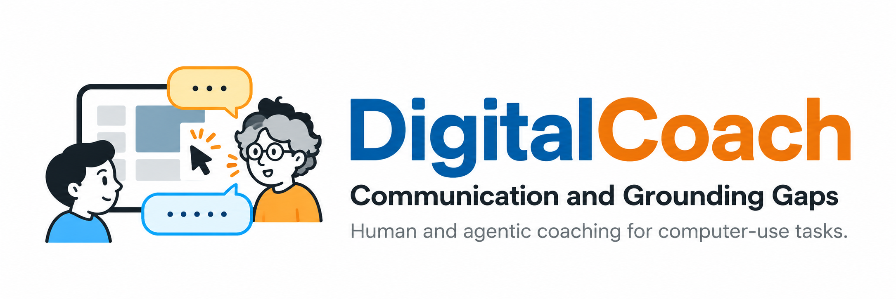

<p align="center">
  
</p>
<p align="center">
<b>
  <a href="https://arxiv.org/abs/2606.31980">DigitalCoach: Communication and Grounding Gaps in Human and Agentic Computer Use Coaching</a>
</b>
</p>
<p align="center">
<b>EMNLP 2026 <span style="color: red; font-style: italic;">(Oral)</span></b>
</p>
<p align="center">
  <a href="https://meng-chen.com">Meng Chen</a><sup>1</sup>,
  <a href="https://anya-ji.github.io">Anya Ji</a><sup>1</sup>,
  <a href="https://patrickthwu.com">Tsung-Han Wu</a><sup>1</sup>,
  <a href="https://tmaringgele.dev">Tobias Maringgele</a><sup>2</sup>,
  <a href="https://dchan.cc">David M. Chan</a><sup>1</sup>,
  <a href="https://www.alanesuhr.com">Alane Suhr</a><sup>1†</sup>,
  <a href="https://amypavel.com">Amy Pavel</a><sup>1†</sup>
</p>
<p align="center">
  <sub><sup>1</sup>UC Berkeley &nbsp; <sup>2</sup>TU Munich &nbsp; <sup>†</sup>Equal supervision</sub><br>
</p>
<p align="center">Evaluating VLMs on real-time, long-horizon computer use task coaching</p>

<p align="center">
  <a href="https://arxiv.org/abs/2606.31980"></a>
  <a href="https://aclanthology.org/2026.emnlp-main.770/"></a>
  <a href="https://huggingface.co/datasets/berkeley-hci/digital-coach"></a>
  
</p>

<p align="center">
  <a href="#what-it-is">What it is</a> &middot;
  <a href="#eval">Eval</a> &middot;
  <a href="#annotation">Annotation</a> &middot;
  <a href="#prototype">Prototype</a>
</p>

---

## Quick Start

```bash
pip install -e ".[eval]"
```

The two core operations — **load** a session, **score** a coach utterance:

```bash
# Load one human–human session from Hugging Face (meta + turns; video on request)
python -c "from digital_coach.dataset import load_session; print(load_session('0101', 'C1L1')['meta'])"

# Preview an input ablation (text only, no screen video downloaded)
python eval/eval_session.py -t 0101 -s C1L1 --vlm-input-modality text-only --dry-run
```

Sessions load from [`berkeley-hci/digital-coach`](https://huggingface.co/datasets/berkeley-hci/digital-coach) via `huggingface_hub`. Human–AI sessions from the prototype use the same files under `results/sessions/`.

## What It Is

This repo is the code behind that comparison:

- dialogue act and coaching method annotation
- CLAIR scoring of generated coach utterances, with input ablations
- a real-time web prototype for VLM coach that calls models through OpenRouter

## Eval

CLAIR (Chan et al., EMNLP 2023) asks an LLM judge (gpt-5.1) to evaluate the similarity between two utterances given the same multimodal input. Scores are 0–100. The judge goes through OpenRouter (`OPENROUTER_API_KEY`).

Input ablations change what the generator sees before that score:

| Flag | Values | What changes |
| --- | --- | --- |
| `--vlm-input-modality` | `text-only`, `text-image`, `image-only` | Transcript, frames, or both |
| `--vlm-context-seconds` | `1`, `10`, `30`, `60` | How much of the session precedes the coach turn |
| `--vlm-prompt-style` | `default`, `teacher`, `oracle` | System prompt. `oracle` reveals the human coaching method |

```bash
cp .env.example .env   # set OPENROUTER_API_KEY

python eval/eval_session.py \
  -t 0101 -s C1L1 \
  --vlm-input-modality text-image \
  --vlm-context-seconds 30 \
  --vlm-prompt-style oracle

# CLAIR against the human coach turns of the same session
python eval/eval_results.py results/eval/0101/C1L1/*.json
```

`text-image` and `image-only` download the session's `screen.mp4`; `text-only` does not. Generations land in `results/eval/<task>/<session>/`. `eval_results.py` pairs each generated turn with the human coach turn by `turn_id`, scores it, and reports the mean overall and per coaching method.

## Annotation

Coach and learner turns are labeled with dialogue acts. Coach turns are also labeled with coaching methods.

**Dialogue acts.** Info Request, Answer, Action Directive, Inform, Opinion, Backchannel, Not Enough Info.

**Coaching methods.** Direct Instruction, Plan, Confirmation, Diagnosis, Explanation, Tip, Clarification, Reflection, Articulation, Exploration, Non-Instructive.

```bash
python annotation/dialogue_acts.py -t 0101 -s C1L1
python annotation/coaching_methods.py --input results/sessions/0101/<call_id>/turns.json
```

Both call OpenRouter (`OPENROUTER_MODEL`) and write to `results/annotation/`. Definitions and examples live in [`annotation/dialogue_acts.py`](annotation/dialogue_acts.py) and [`annotation/coaching_methods.py`](annotation/coaching_methods.py).

## Prototype

`prototype/` is the live human–AI coach: a React learner app and a FastAPI agent. Media goes over GetStream. The default model path is OpenRouter, with Deepgram for speech recognition and ElevenLabs for speech synthesis.

```bash
pip install -e ".[prototype]"
cd prototype/web && npm install && npm run dev
# in another shell, from the repo root:
python prototype/backend_api.py
```

Task prompts are the shared `tasks/` tree. When a call ends, the transcript is written in the same `meta.json` / `turns.json` shape as the recorded sessions, under `results/sessions/`.

Also set `STREAM_API_KEY`, `STREAM_API_SECRET`, `DEEPGRAM_API_KEY`, and `ELEVENLABS_API_KEY`. See `.env.example`.

## Citation

```bibtex
@inproceedings{chen2026digitalcoach,
  title={DigitalCoach: Communication and Grounding Gaps in Human and Agentic Computer Use Coaching},
  author={Chen, Meng and Ji, Anya and Wu, Tsung-Han and Maringgele, Tobias and Chan, David M. and Suhr, Alane and Pavel, Amy},
  booktitle={Proceedings of the 2026 Conference on Empirical Methods in Natural Language Processing},
  year={2026}
}
```

## License

MIT
